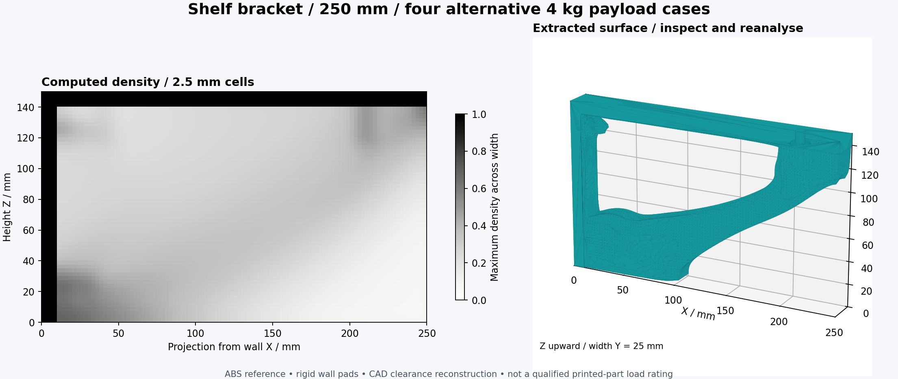

# TopOptLab for Rhino 8 / Grasshopper

**Experimental alpha: 0.4.0-dev — final geometry and engineering workflow preview.** Native Grasshopper components for
2D/3D linear-elastic FEM and topology optimization using Stefan Hiemer's topoptlab.
Numerical regression tests do not replace application-specific engineering qualification.
The newest UI still requires interactive Rhino acceptance.

CPU tests and repository integrity run on pushes and pull requests. A green badge
does not validate the Rhino UI, CUDA, or a physical design. Actions results are linked above.

## Classroom downloads

For the 26 October 2026 course, download **one complete ZIP for your computer**
from the [classroom release](https://github.com/andrea199/TopOptLab-Rhino-Grasshopper/releases/tag/v0.4.0-alpha.20261030). Each package contains the English HTML
manual, HTML lesson slides, all exercise files and its matching offline CPU installer.

| Computer | Complete course package | Size |
| --- | --- | ---: |
| Windows x64, Rhino 8 | [Windows](https://github.com/andrea199/TopOptLab-Rhino-Grasshopper/releases/download/v0.4.0-alpha.20261030/Lecture_26102026_Windows.zip) | 220.63 MB |
| Mac Apple Silicon, macOS 15+, Rhino 8 | [Apple Silicon pilot](https://github.com/andrea199/TopOptLab-Rhino-Grasshopper/releases/download/v0.4.0-alpha.20261030/Lecture_26102026_Mac_AppleSilicon.zip) | 229.40 MB |
| Mac Intel, macOS 15+, Rhino 8 | [Intel pilot](https://github.com/andrea199/TopOptLab-Rhino-Grasshopper/releases/download/v0.4.0-alpha.20261030/Lecture_26102026_Mac_Intel.zip) | 239.29 MB |

All packages are below 250,000,000 bytes. Extract the entire ZIP, open
`START_HERE.html`, then choose **Open the complete English manual**. Keep its
`software` folder with that page. See [installation](docs/INSTALLATION.md) and
the [release scope and checksums](docs/RELEASE_2026-10-26.md).

This clean repository is private during publication review. Release downloads
currently require a GitHub account with repository access.
The Mac packages are pilots; native Rhino/Mac acceptance is pending.
Windows runtime and bridge checks passed in isolation; a student Rhino session
and a second Windows PC still require practical acceptance. There is no verified
installer for Linux, Windows ARM or macOS versions below 15.

## Start here

| Goal | Guide |
| --- | --- |
| Run your first FEM and optimization | [Quick start](docs/QUICKSTART.md) |
| Choose a ready-made model | [20-example gallery](docs/EXAMPLES.md) |
| Learn or teach TopOptLab in English | [Unified manual: components and lessons](docs/manual/index.html) |
| Find technical documentation | [Documentation index](docs/README.md) |
| Build, test or contribute | [Contributing](CONTRIBUTING.md) |

The repository includes the integration source, the complete upstream snapshot,
editable examples, icons, tests and a roof-rib teaching kit. The Windows source
installer creates the local Python environment and compiles the plugin. The
published English teaching material includes the HTML manual, 56 HTML lesson
slides, illustrated installation, component explanations and exercise files.
PowerPoint files are maintained separately by the instructor and are not included
in the repository or its release packages.

*Computed fine-grid shelf study; final conforming FEM of this candidate remains
incomplete. See the validation scope below.*

## Teaching manual

The canonical English teaching manual is in [`docs/manual/`](docs/manual/index.html).
Open its `index.html` locally to browse the Component Guide and the sequential
Learnings section from one navigation. All eight lessons are available, with 56
HTML lesson slides, teacher guides, student worksheets and linked exercise files.
The manual includes an [illustrated installation guide](docs/manual/getting-started/installation/index.html),
a [component and port introduction](docs/manual/learnings/component-primer/index.html),
and [wiring walkthroughs](docs/manual/learnings/connections/index.html).
PowerPoint presentations are distributed separately by the instructor; use the
HTML lesson slides and illustrated setup guide included here.
See [authoring instructions](docs/manual/AUTHORING.md) before adding new material.
The [documentation hosting guide](docs/DOCUMENTATION_HOSTING.md) explains the
Read the Docs build; it serves this same manual without maintaining another site.
The original Italian roof-rib course remains in `teaching/roof_2d/` as reference
material. New English lessons are developed inside the unified manual.

## Workflow

Geometry → Material and Units → Supports → Load Cases → Baseline FEM → Optimization
→ Voxel Verification → Final Surface → Conforming Final FEM → Engineering Report.

Start with tool/examples/engineering_workflow_2d.gh or engineering_workflow_3d.gh.
Twenty English example documents are included. Run the three stages in order.
Use each stage's Report output to locate report.html.
For pressure and self-weight, start with engineering_distributed_loads_2d.gh or
engineering_distributed_loads_3d.gh and read [distributed loads](docs/DISTRIBUTED_LOADS.md).

For design limits and the new review controls, use engineering_design_limits_2d.gh or
engineering_design_limits_3d.gh and read [design limits](docs/DESIGN_LIMITS.md).
Both are teaching examples with explicit limits, not a material design code.

For a complete 3D workflow through extracted surface and conforming FEM, use
**tool/examples/engineering_final_geometry_3d.gh** and read [Final Geometry](docs/FINAL_GEOMETRY.md)
and [3D Printing Review](docs/PRINT_REVIEW.md). Stage 3 shows the surface and print
flags; Stage 4 shows the new tetrahedral FEM response.

For a real-size 250 mm ABS-reference shelf bracket with four independent 4 kg load cases,
open **tool/examples/engineering_shelf_bracket_3d.gh**. Parametric holes, protected plates
and tool-clearance voids are included. See [Shelf Bracket](docs/SHELF_BRACKET.md).
The updated 2.5 mm example passes voxel reanalysis at threshold 0.32; automatic
tetrahedral meshing of its final CAD surface remains incomplete. The previous 5 mm
shape completed the separate CAD/FEM workflow. See the exact [validation scope](docs/RESOLUTION_VALIDATION.md).

## Implemented

These are the **integration's exposed workflows**, not an upstream feature
catalogue. See [TopOptLab upstream](https://github.com/stefanhiemer/topoptlab)
and the [bundled snapshot README](vendor/topoptlab/README.md) for upstream
documentation, and [third-party notices](THIRD_PARTY_NOTICES.md)
for snapshot provenance. New upstream features are not automatically available here.

- Q4 plane-stress 2D and HEX8 solid 3D FEM, stress/displacement/reaction results.
- SIMP compliance minimization with volume budget and preserved material regions.
- Optional all-case displacement/stress constraints using MMA and checked adjoint derivatives.
- Explicit relaxed design stress, numerical feasibility and distinct optimizer-failure status.
- Review controls: one visible stage, saved case selection, viewport legend and baseline comparison.
- Integrated fixed-boundary pressure/traction loads and density-dependent self-weight in 2D/3D.
- Optional preservation of support/point-load attachments; surface-load interfaces always preserved.
- Independent named load cases with positive objective weights; forces within a case act together.
- Explicit mm/m and N/kN units; documented structural-steel and ABS reference presets.
- CPU direct, CPU CG, CPU AMG, CPU matrix-free, and optional CUDA CG backends.
- Shared matrix/preconditioner across load cases and warm starts between iterations.
- Cached block assembly, elasticity AMG modes, linear-storage symmetry/extrusion projection,
  FFT cone filtering, explicit physical filter radius and 3D memory admission estimates.
- Boundary-only grid preview and cached unchanged result snapshots.
- Shelf-specific nominal CAD plate/clearance reconstruction with a recorded chord tolerance
  and physical load-patch transfer; see [CAD interfaces](docs/CAD_INTERFACES.md).
- Objective/design convergence window, distinct iteration-limit status and cancellation.
- Symmetry and 3D extrusion density constraints with derivative checks.
- Binary voxel threshold reanalysis, connected-domain and selected-node validation.
- Continuous 3D isosurface extraction, exact voxel Keep preservation, closure/connectivity
  checks, edited-mesh validation and STL export.
- Gmsh conforming TET4 remesh and full-material FEM, with explicit support/load transfer,
  force/moment/energy checks, independent case responses and one-to-three-level mesh studies.
- 3D printing geometry review: build direction, overhangs and sampled normal wall thickness.
  These print checks flag geometry; they are not optimization-enforced printability constraints.
- Saved project JSON, per-case FEM/optimization JSON, history, mass and HTML report.
- Parametric dimensions and XYZ position in the examples.

## Install from source on Windows

For the offline classroom installer, use the platform ZIPs above.

- Prerequisites: **Rhino 8 and Python 3.13 (64 bit)**, plus internet access.
- Download/clone the complete repository into a permanent folder.
- Save and close Rhino, then run `INSTALL.cmd`.
- Optional NVIDIA CUDA: run `INSTALL.cmd --cuda`; CPU is the default.
- See [Installation](docs/INSTALLATION.md) for nonstandard paths, preparation,
  backups, updates and troubleshooting.

## Validation and performance

See [validation](docs/VALIDATION.md), [raw benchmarks](docs/benchmarks.json),
[reference run](docs/reference-validation.json), [user guide](docs/USER_GUIDE.md),
and the [development plan](docs/DEVELOPMENT_PLAN.md).

On the development PC (Core Ultra 9 285H, 64 GB RAM, RTX 5070 Laptop 8 GB), a
13,824-voxel FEM benchmark took approximately 1.31 s with CPU matrix-free and 1.81 s
with CUDA, including model/backend setup. These are single-run timings, not promised
speedups. GPU context startup matters. CPU thread settings limit BLAS threads;
they do not mean every solver stage is parallel.

## Scope and limits

- Linear isotropic small-strain elasticity only. Stress screening is not code compliance.
- Default 3D Domain limit: 8,000 cells. The shelf example uses a 250,000-cell
  user limit and 2.5 mm cells (60,000 bounding cells).
- Memory admission and absolute guards (2,000,000 bounding cells; 2,048 per axis)
  are not tested-capacity or accuracy claims. See [resolution evidence](docs/RESOLUTION_VALIDATION.md).
- Stage 2 checks the original voxel grid; Stages 3/4 extract a smoothed surface
  and remesh with TET4. Keep/envelope regions remain authoritative.
- The shelf CAD contract restores nominal plates/clearances and rechecks load regions.
  Final supports require complete boundary-face patches; removed load interfaces are rejected.
- TET4 needs bending/stress refinement studies. No evolving-surface pressure,
  buckling, fatigue, plasticity or contact.
- Self-weight optimization uses a fixed material budget and projected-gradient updates
  (or MMA when design limits are enforced). Stress-constrained and low-density
  behavior remains experimental and must be checked on the final shape.
- Process notes and feature-size erosion are diagnostic; only symmetry,
  extrusion and Keep are enforced manufacturing-related controls today.

## Development and attribution

- Run `.venv/Scripts/python -m pytest` for integration regressions.
- Run `.venv/Scripts/python tool/tools/benchmark_engineering.py` for full-solid FEM measurements.
- Run `.venv/Scripts/python tool/tools/benchmark_final_workflows.py --cuda` for short
  constrained workloads; add `--surface PATH/TO/surface/result.json` for final FEM.
- See [0.4 performance evidence](docs/PERFORMANCE_04.md) for scope and measured data.
- Native SDK/bridge acceptance requires Rhino; CPU and archive regressions run in CI.
- See [LICENSE](LICENSE) and [third-party notices](THIRD_PARTY_NOTICES.md).
- The transferred upstream source is included unchanged with a SHA-256 manifest.
  No upstream Git revision is claimed.
- See [Contributing](CONTRIBUTING.md) for upstream updates and release gates.

<!-- FUNDING ACKNOWLEDGEMENT START -->
## Funding acknowledgements

The authors acknowledge support from the ARCHIBIOFOAM project, which received funding from the European Union’s Horizon Europe research and innovation programme under grant agreement No 101161052.

Views and opinions expressed are however those of the author(s) only and do not necessarily reflect those of the European Union or European Innovation Council and SMEs Executive Agency (EISMEA). Neither the European Union nor the granting authority can be held responsible for them.

[ARCHIBIOFOAM — project and grant information](https://cordis.europa.eu/project/id/101161052).
<!-- FUNDING ACKNOWLEDGEMENT END -->
