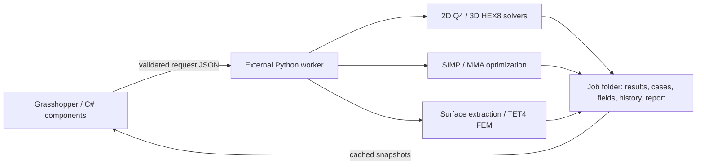

# Architecture

| Location | Responsibility |
| --- | --- |
| `tool/src/` | C# Grasshopper components, geometry conversion, job control and preview |
| `tool/worker.py`, `tool/worker3d.py` | Worker entry point and numerical execution |
| `tool/engineering.py` | Materials, independent load cases and engineering workflow |
| `tool/fem_backends.py` | Explicit CPU/CUDA linear solvers and numerical checks |
| `tool/grid_filter.py`, `tool/resource_budget.py` | Filtering, projection and capacity admission |
| `tool/final_geometry.py`, `tool/tetra_mesh.py`, `tool/final_workflow.py` | Final surface and conforming FEM |
| `tool/cad_interfaces.py`, `tool/final_loads.py` | Shelf CAD contracts and load/support transfer |
| `tool/tests/` | Numerical and archive regressions |
| `tool/tools/` | Example generators, native integration probes and benchmarks |
| `tool/examples/` | Editable GH definitions and matching GHX archives |
| `vendor/topoptlab/` | Unmodified upstream snapshot by Stefan Hiemer |
| `teaching/roof_2d/` | Ready-to-teach roof lesson, source and reference calculations |

Rhino and Python run in separate processes. The installer writes the local Python
and worker locations; those machine paths are not repository configuration.
Long-running jobs save progress, accept cancellation, and retain their own result
folders. Keep full job folders when archiving results, including NPZ arrays for
large models. Backend selection never silently substitutes a different solver.

The generic voxel workflow and optional shelf-specific CAD reconstruction have
different geometry contracts. The latter restores nominal plates/clearances;
neither a closed mesh nor a successful linear solve alone establishes structural
qualification. See [final geometry](FINAL_GEOMETRY.md).
