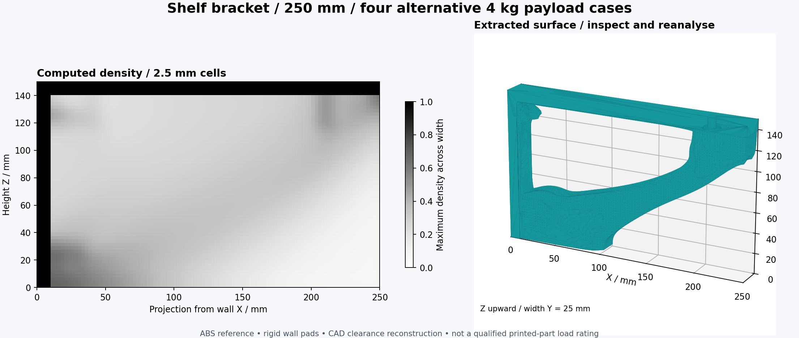

# Shelf bracket — 3D parametric engineering example

Open **tool/examples/engineering_shelf_bracket_3d.gh** after installing the matching plugin build. Geometry is internal: no Rhino selection is required. Run buttons are idle when opened.

This is a **250 mm shelf bracket carrying 4 kg per bracket**, fixed to a wall. It is a preliminary linear-elastic study, not a certified load rating.

## Defaults and assumptions

| Input | Default | Meaning |
|---|---:|---|
| Length / Height / Width | 250 / 150 / 25 mm | X projects from wall; Z is up; Y is width |
| Plate thickness | 10 mm | Preserved wall and shelf attachment plates |
| Nominal hole diameter | 8 mm | Study clearance, not a selected fastener specification |
| Wall hole pitch | 100 mm | Two vertically spaced wall holes |
| Top hole inset | 40 mm | Shelf holes at x=inset and x=Length-inset |
| Tool clearance | diameter 16 mm; depth 25 mm | Reserved head/tool volumes on accessible sides |
| Payload per bracket | 4 kg | Never divided by the number of brackets |
| Shelf share | 0.5 kg | **Assumed** shelf mass carried by this bracket; replace with actual allocation |
| Front patch depth | 20 mm | Actual default centroid x=240 mm |
| Side offset fraction | 0.6 | Nominal eccentricity fraction of half width; actual centroid is reported |
| Cell size | 2.5 mm | 60,000 bounding cells; 58,552 active cells |
| Voxel limit | 250,000 | User admission limit, also subject to free-memory checks |
| Physical filter radius | 9 mm | Fixed physical neighborhood when refining the grid |
| CAD chord tolerance | 0.05 mm | Radial clearance overcut, independent of voxel size |
| Final tetrahedral size | 4 mm | Independent conforming-FEM mesh parameter |
| Volume fraction | 0.35 | Includes Keep; not the final exported mass fraction |
| Verification threshold | 0.32 | Verified on the fine voxel model; reanalyse after every design/grid change |
| Solver | 4: CUDA CG | Prepared for this NVIDIA development PC; choose 2: CPU AMG explicitly on a CPU-only PC |
| Iteration limit | 60 | An iteration limit is different from convergence |
| Displacement target | 1 mm | Chosen functional target, not a standard |
| Stress design limit | Off | Printed-material allowable has not been established |

The ABS preset is an **injection-moulded Terluran GP-22 reference**: E=2300 MPa, nu=0.35 (assumed), density=1040 kg/m3. It does not identify printed ABS or an ABS-like resin. It does not qualify creep, temperature or layer adhesion.

Units must be **mm and N**. Conditions reject incompatible Material units. Gravity is 9.80665 m/s2. Translation moves all interfaces together; resizing does not scale hole diameters.

## Envelope, holes and protected interfaces

Shelf Bracket 3D generates B (design envelope), Void (four holes and four tool cylinders), Keep (both attachment plates), and Spec (dimensions for Bracket Cases 3D).
Voids take precedence over Keep. Surrounding plate material remains solid while holes remain empty.

The updated example also connects Spec and the Bracket Cases loading summary to Final Geometry 3D. This shelf-specific contract reconstructs nominal attachment plates and circular screw/tool clearances after density extraction. Triangulated circles use circumscribed polygons with radial overcut bounded by the declared tolerance; a 0.05 mm radial tolerance can increase local diameter by up to 0.10 mm. This is a CAD-derived triangle surface, not an exact BRep or a qualified printed fit. [CAD interfaces](CAD_INTERFACES.md) explains provenance and physical load transfer.

Continuous attachment plates are intentional. The optimiser redistributes the connecting web. Tool clearance is a reserved volume, not a guarantee of access, reach or assembly.

The file **shelf_bracket_nominal_interfaces.3dm** describes initial CAD attachments, not an optimised printable part.

## Wall connection

X/Y/Z displacement is fixed on **two complete rear voxel-face patches around the wall holes**. Nominal patch height = tool diameter + plate thickness. Selection uses facet centres. Full faces allow transfer to final conforming FEM.

These are ideal rigid pads, not screw elements. Wall contact, bolt preload, washers, anchor pull-out, wall material and plastic creep are not simulated. Reactions are loads for a later anchorage study, not anchor capacities.

## Four independent cases

Each case contains one payload, distributed shelf share (unless zero), and density-dependent bracket self-weight. The cases are **alternatives**, not simultaneous payloads.

| Case | Payload application | Historical 5 mm raster centroid, mm | Payload moment at wall origin, N mm |
|---|---|---|---|
| 1 Distributed | Top interface, excluding holes | (125, 0, 150) | (0, 4903.325, 0) |
| 2 Front | Last 20 mm of top interface | (240, 0, 150) | (0, 9414.384, 0) |
| 3 Front right | Right portion of front strip | (240, 7.5, 150) | (-294.1995, 9414.384, 0) |
| 4 Front left | Left portion of front strip | (240, -7.5, 150) | (294.1995, 9414.384, 0) |

Payload force is **39.2266 N downward** in every case. Shelf share adds **4.903325 N** at default. Self-weight changes with design mass.

The historical 5 mm raster front strip has centroid x=240 mm: moment is **9.414384 N m**, not the 9.80665 N m of a point exactly at 250 mm. Info reports actual force, area, centroid and moment after changes.

Traction = total force / selected facet area. Grid and size changes do not multiply the applied mass. Unresolved side patches are rejected. Coarse-grid eccentricity can differ from the nominal slider.

## Step by step

1. Inspect geometry and payload sliders on the left. Start at defaults; replace assumed shelf share.
2. Read Material Info. Keep mm/N. ABS is selected automatically.
3. Press **RUN under BASELINE FEM**, then VIEW=0. Inspect Cases 1–4. Field=1 displacement; Field=2 stress. Open Report.
4. Press **RUN under OPTIMIZATION**, then VIEW=1. Four cases contribute to the objective; displacement is constrained in each case. Stress limit is disabled.
5. Read termination and feasibility separately. Iteration_limit does not mean convergence. Stop cancels; Reset detaches. After input changes, reset and rerun from baseline.
6. Press **RUN under FINAL VERIFICATION**, then VIEW=2. This is full-material thresholded voxel FEM, not a smooth geometry or independent mesh.
7. Press **EXTRACT**, then VIEW=3. Inspect surface, retained interfaces and print flags. Build direction +Y proposes printing on the side; it does not rotate the STL.
8. **FINAL FEM**, then VIEW=4, is the separate tetrahedral analysis. The new 2.5 mm / threshold 0.32 surface currently fails automatic Gmsh parameterization; this stage remains incomplete for that candidate. The previous 5 mm shape passed all four cases. After meshing is accepted, start with one level and investigate convergence with three levels.
9. Use **BAKE** to create Rhino geometry. Check Undo interactively; SDK tests do not exercise viewport actions.
10. Before manufacture, establish exact interfaces, material/process, anchorage and a prototype test plan.

## Hole resolution

An 8 mm hole spans 1.6 cells on the old 5 mm grid, 3.2 cells at 2.5 mm, and 4 at 2 mm.
These are design-grid representations, not screw-fit or converged bearing-stress models.
At 2.5 mm the 60,000 bounding cells are now admitted when selected limit and free-memory
checks pass. At 2 mm there are 121,875 bounding cells. Resizing changes these counts.

The optional shelf CAD contract restores circular clearances after density extraction,
with a declared triangulation tolerance independent of the voxel grid. Generic extraction
without that contract still preserves the voxel Keep/envelope. No exact BRep or printed
fit is claimed. Final FEM uses the exported CAD-derived surface and its recorded loads.

Web cleanup defaults to 0.01 mm before nominal plates and voids are restored; its actual
geometry is exported and hashed. Envelope cleanup is a separate optional plane-snap
operation, disabled by default. These advanced controls are geometric changes followed
by reanalysis, not display smoothing or a way to bypass FEM quality checks.

## Reproduction

Use the project Python:
- tool/build.py — compile.
- tool/tools/generate_example.py --shelf-only — GH/GHX archive and SDK readback.
- tool/tools/test_shelf_bracket.py — actual RhinoCore/Grasshopper dataflow for four size/position/grid variants.
- -m pytest tool/tests/test_shelf_bracket.py -q — analytical raster and force/moment checks.
- tool/tools/validate_shelf_bracket.py --backend cuda-cg --final-fem — baseline, optimisation, threshold check, extraction and final FEM.

Native fixture outputs are in tool/build/shelf-bracket-probe. Versioned regression fixtures are in tool/tests/fixtures/shelf_bracket; update deliberately after rerunning the native harness.

Full workflow outputs use a fresh folder under tool/build/shelf-bracket-runs. See **docs/RESOLUTION_VALIDATION.md** for the latest measurements and remaining acceptance. **docs/SHELF_BRACKET_VALIDATION.md** records the earlier 5 mm run only.

The conditions component rejects a nominal hole that vanishes completely on the selected grid. A represented hole can still be too coarse for an accurate local stress or fit.

## Computed preview

The 2.5 mm / 60-update result at threshold 0.32, with reconstructed nominal interfaces.
Voxel FEM passes the chosen 1 mm displacement limit; this image is not evidence of a
converged final-surface FEM or a qualified printed-part load rating. See the current
validation record for the separate tetrahedral meshing status.

## Resolution controls

Cell size controls the HEX8 design/FEM grid. 2.5 mm gives 60,000 bounding cells; 2 mm gives 121,875 because dimensions are rounded up to whole cells. Reducing every cell edge by half costs roughly eight times as many 3D elements. Use the Domain Resources output before Run. The selected Voxel limit and free-memory estimates can both reject a model; an absolute 2,000,000-cell / 2,048-per-axis guard is not a validated capacity claim.

Keep Physical filter radius at 9 mm when comparing grid refinements. Changing only a radius measured in cells changes the optimization problem. The final CAD clearance tolerance and final tetrahedral size are separate from Cell size. Smooth display does not prove converged stress.

Large jobs store full Gauss stress tensors in per-case NPZ files instead of duplicating them in every JSON snapshot. Preview stress, displacement and reactions remain available. Keep the whole job folder, including NPZ, JSON and reports.
